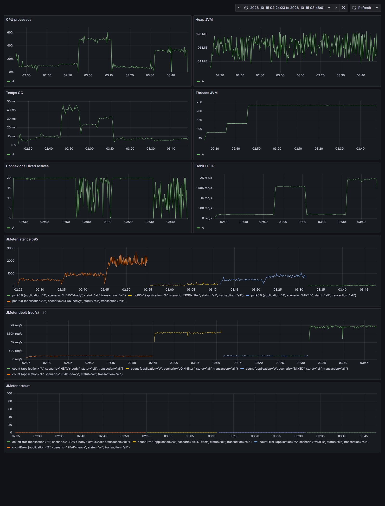
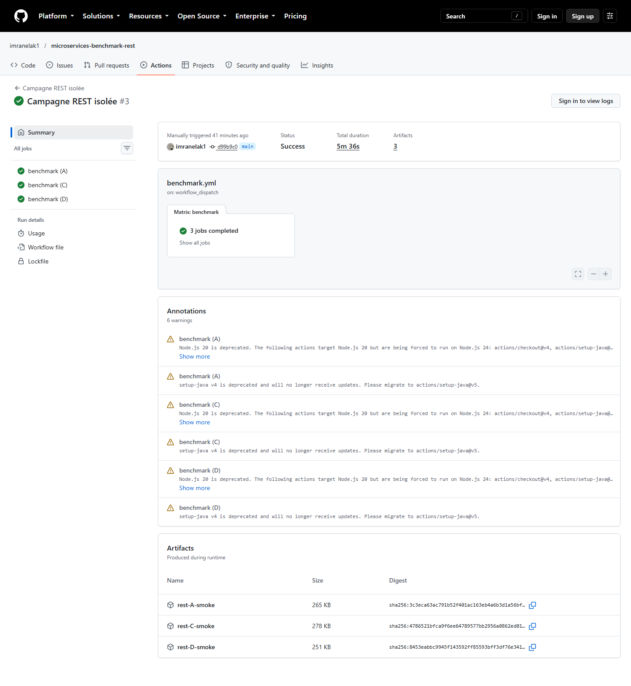

# Étude de cas — Benchmark REST

J’ai implémenté le même catalogue avec Jersey, Spring MVC et Spring Data REST. Les trois applications utilisent les mêmes entités et repositories JPA, avec 2 000 catégories et 100 000 produits dans trois schémas PostgreSQL séparés. Les routes CRUD, filtres et relations sont testés dans chaque variante.

```bash
docker compose up -d
mvn clean verify
# Lancer séparément les jars variant-a-jersey, variant-c-mvc et variant-d-data-rest
```

Les API écoutent sur 19401, 19402 et 19403. Les plans `loadtests/*.jmx` couvrent READ-heavy, JOIN-filter, MIXED et HEAVY-body avec les paliers du sujet. Les paramètres `duration`, `rampUp` et `port` peuvent être remplacés en ligne de commande JMeter.

Grafana est sur 19430, Prometheus sur 19490 et InfluxDB sur 19486. Les identifiants locaux sont `student / labpassword`. Les résultats réels, la configuration de la machine et les tableaux T0 à T7 sont dans `results/`. L’analyse précise les limites d’une exécution sur machine partagée.



